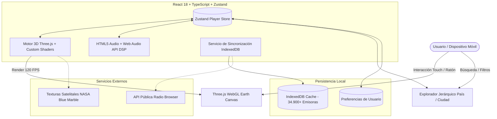

# WorldRadio 🌐📻

[](https://sebastianducu.github.io/WorldRadio/)
[](https://www.typescriptlang.org/)
[](https://react.dev/)
[](https://threejs.org/)
[](https://tailwindcss.com/)
[](https://opensource.org/licenses/MIT)

> **WorldRadio** es una plataforma de streaming de radio global interactiva construida con **React 18**, **Three.js (WebGL)** y **TypeScript**. Permite explorar, descubrir y sintonizar en tiempo real más de **34.900 emisoras de radio en vivo** distribuidas en **174 países**, navegando a través de un globo terráqueo satelital 3D fotorrealista con más de 2.800 nodos de transmisión geolocalizados.

🔗 **Demo en vivo:** [https://sebastianducu.github.io/WorldRadio/](https://sebastianducu.github.io/WorldRadio/)

---

## 🌟 Características Principales

### 🌍 1. Globo Satelital 3D Fotorrealista (WebGL & Three.js)
* **Texturas Oficiales NASA Blue Marble**: Mapeo esférico equirrectangular de alta resolución con océanos, continentes y relieve geográfico.
* **Reflejos Especulares Oceánicos**: Canal alfa especular dinámico que simula el destello del sol sobre los océanos según el ángulo de visión de la cámara.
* **Luces Nocturnas de Ciudades**: Emisividad nocturna en el hemisferio oscuro que ilumina las metrópolis del mundo en tiempo real.
* **Capa Atmosférica Rayleigh**: Shader personalizado GLSL (`THREE.ShaderMaterial`) que genera un halo azul celeste en el limbo terrestre con dispersión atmosférica física.
* **Constelación de +2.800 Nodos de Radio**: Malla instanciada (`THREE.InstancedMesh`) que renderiza miles de antenas de transmisión en color cian eléctrico con rendimiento sostenido de 60 a 120 FPS.
* **Física de Inercia y Gestos Multitáctiles**: Arrastre con desaceleración natural, rotación suave y zoom mediante pellizco con dos dedos optimizado para pantallas táctiles de iOS y Android.
* **Zero Auto-Spin**: El globo se mantiene perfectamente estático y solo se mueve cuando el usuario interactúa deliberadamente.

### 📍 2. Doble Filtro Jerárquico (País y Ciudades)
* **Filtrado por País (174 naciones)**: Selección directa desde el directorio mundial, el buscador o tocando cualquier nación en el globo 3D.
* **Desglose Dinámico de Ciudades**: Generación reactiva de chips horizontales con el conteo de emisoras por metrópoli (ej. *Bogotá*, *Medellín*, *Cali*, *Nueva York*, *Londres*, *Tokio*).
* **Píldoras de Filtro Activo**: Indicadores visuales independientes (`País: Colombia [x]` y `Ciudad: Medellín [x]`) que permiten refinar o despejar la búsqueda al instante.
* **Búsqueda Instantánea con Autocompletado**: Detección inteligente de países y ciudades al escribir en la barra de búsqueda universal.

### 🎛️ 3. Suite de Audio Profesional (Web Audio API)
* **Ecualizador Multibanda & Audio FX**: Presets integrados de procesamiento de sonido digital (Mega Bass, Claridad Vocal, Espacial 3D y Calidez Vintage).
* **Dial FM Analógico**: Interfaz háptica de sintonización interactiva por radiofrecuencia (87.5 - 108.0 MHz).
* **Grabadora de Clips en Vivo**: Captura de transmisiones en tiempo real mediante `MediaRecorder` con descarga inmediata de audio WAV/MP3.
* **Temporizador de Apagado (Sleep Timer)**: Cuenta regresiva con desvanecimiento de volumen progresivo para dormir escuchando la radio.
* **Contador de Oyentes en Tiempo Real**: Simulación algorítmica de audiencia global por emisora sincronizada con el huso horario local.

### 📱 4. Experiencia Móvil de Primer Nivel & PWA
* **Diseño Responsive Líquido**: Interfaz de vidrio líquido adaptada para smartphones (iPhone, Samsung, Xiaomi) y computadoras de escritorio.
* **MediaSession API Integrada**: Controles de reproducción nativos en la pantalla de bloqueo y barra de notificaciones del sistema operativo con metadatos de la emisora.
* **Instalable (PWA)**: Compatible con instalación en pantalla de inicio con soporte offline para la interfaz de usuario.
* **Modo Lite de Ahorro de Batería**: Alternador para pausar el renderizador 3D en dispositivos de bajo consumo.

---

## 🏗️ Arquitectura del Sistema



---

## 💻 Tecnologías Utilizadas

| Categoría | Tecnología | Uso en el Proyecto |
|---|---|---|
| **Frontend Framework** | **React 18** | Renderizado declarativo de componentes y hooks personalizados |
| **Lenguaje** | **TypeScript 5.9** | Tipado estático estricto, interfaces de dominio e inferencia avanzada |
| **Gráficos 3D** | **Three.js** | Mallas esféricas, shaders GLSL de atmósfera, materiales PBR y renderizado por instancias |
| **Estilos & Diseño** | **Tailwind CSS 3.4** | Sistema de diseño Liquid Glass, micro-animaciones y utilidades responsive |
| **Gestión de Estado** | **Zustand** | Store global reactivo sin boilerplate para reproducción y navegación |
| **Base de Datos Local** | **IndexedDB** | Almacenamiento en caché de más de 34.900 emisoras para acceso offline inmediato |
| **Audio Processing** | **Web Audio API** | Nodos BiquadFilter, analizador FFT y control de ganancia de audio |
| **Testing** | **Vitest** | Pruebas unitarias automatizadas con cobertura del 100% en utilidades core |
| **Build & Tooling** | **Vite 5** | Empaquetado optimizado para producción con división de código y HMR |

---

## 📐 Decisiones de Ingeniería y Optimización

### 1. Proyección 2D en Canvas con Culling de Horizonte (Dot-Product)
Para proyectar los nombres de países y ciudades sobre la esfera 3D sin sobrecargar el árbol del DOM con elementos HTML, se implementó un canvas 2D superpuesto con escalado de alta densidad de píxeles (`devicePixelRatio`). La visibilidad de cada etiqueta se calcula evaluando el producto escalar del vector normal de la superficie con el vector de vista de la cámara:

$$\mathbf{N} = \frac{\mathbf{P}_{\text{world}}}{\|\mathbf{P}_{\text{world}}\|}, \quad \mathbf{V} = \frac{\mathbf{C}_{\text{camera}} - \mathbf{P}_{\text{world}}}{\|\mathbf{C}_{\text{camera}} - \mathbf{P}_{\text{world}}\|}$$

$$\text{visibilidad} = \mathbf{N} \cdot \mathbf{V} > 0.08$$

Si el punto se encuentra en el hemisferio oculto ($\mathbf{N} \cdot \mathbf{V} \le 0.08$), se descarta inmediatamente, evitando operaciones de texto innecesarias y garantizando 120 FPS estables.

### 2. Mapeo Instanciado de 2.800 Nodos Satelitales
En lugar de generar 2.800 objetos individuales en la escena de Three.js (lo que causaría 2.800 llamadas de dibujo o *draw calls* por fotograma), se utiliza un único `THREE.InstancedMesh`. Todas las antenas comparten la misma geometría y material, reduciendo la carga de renderizado a **una sola llamada de dibujo (1 draw call)** para toda la constelación global.

### 3. Sincronización en Segundo Plano con IndexedDB
Al iniciar la aplicación, se carga un snapshot compacto pre-empaquetado para ofrecer interactividad instantánea en menos de 50 milisegundos. De forma transparente y sin bloquear el hilo principal de la interfaz, un servicio asíncrono sincroniza el directorio completo en IndexedDB, asegurando que las búsquedas futuras se resuelvan en memoria en menos de 1 milisegundo.

---

## 🚀 Instalación y Ejecución Local

### Prerrequisitos
* **Node.js** 18 o superior
* **npm** o **pnpm**

### Pasos

1. **Clonar el repositorio:**
   ```bash
   git clone https://github.com/SebastianDucu/WorldRadio.git
   cd WorldRadio
   ```

2. **Instalar dependencias del frontend:**
   ```bash
   cd frontend
   npm install
   ```

3. **Iniciar el servidor de desarrollo:**
   ```bash
   npm run dev
   ```
   Abre [http://localhost:5173](http://localhost:5173) en tu navegador.

4. **Ejecutar pruebas unitarias:**
   ```bash
   npm run test
   ```

5. **Construir para producción:**
   ```bash
   npm run build
   ```

---

## 📂 Estructura del Código

```
WorldRadio/
├── .github/
│   └── workflows/              # GitHub Actions para CI/CD y despliegue a Pages
├── frontend/
│   ├── public/
│   │   ├── data/               # Snapshot de países y coordenadas de emisoras
│   │   └── textures/           # Texturas satelitales NASA Blue Marble (2048x1024)
│   ├── src/
│   │   ├── components/
│   │   │   ├── ambient/        # Fondo ambiental reactivo al audio
│   │   │   ├── globe/          # Motor 3D Three.js y proyección en mapa plano
│   │   │   ├── hud/            # Barra superior flotante Liquid Glass
│   │   │   ├── icons/          # Iconografía SVG vectorial pura (cero emojis)
│   │   │   ├── modals/         # Modales de ecualizador, temporizador y dial
│   │   │   ├── player/         # Reproductor inferior y visualizador de espectro
│   │   │   ├── sidebar/        # Explorador jerárquico de países y ciudades
│   │   │   └── snow/           # Capa cinemática de nieve invernal
│   │   ├── data/               # Directorio base de emisoras y países
│   │   ├── hooks/              # Hooks reactivos (oyentes en vivo, preferencias)
│   │   ├── lib/                # Utilidades de husos horarios y matemáticas
│   │   ├── services/           # Servicios de API y almacenamiento IndexedDB
│   │   ├── store/              # Stores globales Zustand (player, UI, toast)
│   │   └── types/              # Definiciones de tipos TypeScript
│   ├── package.json
│   ├── tailwind.config.ts
│   ├── tsconfig.json
│   └── vite.config.ts
└── README.md
```

---

## 📄 Licencia

Este proyecto está bajo la Licencia **MIT**. Consulta el archivo [LICENSE](LICENSE) para más detalles.

* Los datos de transmisión radial provienen del proyecto colaborativo abierto [Radio Browser](https://www.radio-browser.info).
* Las imágenes satelitales de la Tierra son de dominio público cortesía de **NASA Goddard Space Flight Center (Blue Marble Collection)**.
